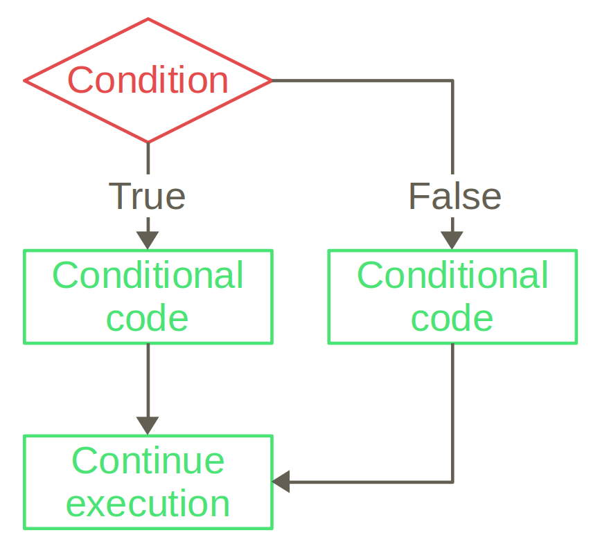

> **How to read the code boxes:** grey boxes with a yellow bar contain Python
> code. The box labelled **Output** next to it (or below it) shows what Python
> prints when you run that code.

## True or False: booleans

- A **boolean** (`bool`) has one of two values: `True` or `False`. They must be
  capitalized.

```python
true_or_false = True
print(true_or_false)
```

```output
True
```

- Booleans most commonly come from **comparison operators**:

```python
print(3 > 2)    # greater than
print(3 <= 2)   # less or equal
print(4 == 4)   # equal
print(4 != 4)   # not equal
```

```output
True
False
True
False
```

- `=` and `==` are different: `x = 5` **stores** a value in `x`, while `x == 5`
  **compares** `x` with 5 and gives `True` or `False`.

## Combining conditions

- `and` and `or` are **boolean operators**. `and` is `True` only if both sides
  are `True`; `or` is `True` if at least one side is `True`.

```python
print(3<2 and 4>2)
print(3<2 or 4>2)
```

```output
False
True
```

- `not` negates a boolean, so it has only one operand: `not True` is `False`.

## If-else

- So far every line of code was executed by Python. `if` runs a block of code **only if a
  condition is `True`**.

```python
num = 7
if num>3:
    print(num, "is greater than 3.")
print("Done.")
```

```output
7 is greater than 3.
Done.
```

- The `if` line ends with a colon `:`, and the **indented** lines below it are
  the code that runs conditionally.
- `else` adds code that runs when the condition is `False`:

```python
age_of_retirement = 65
name = "Methuselah"
age = 913

if age < age_of_retirement:
    print(name, "is not retired.")
else:
    print(name, "is retired.")
```

```output
Methuselah is retired.
```

::: {.side-figure}
- **Control flow** is the order in which the commands are executed. `if`-`else`
  is a **control flow statement**: it introduces a branch in the program.


:::

## More options: `elif`

- `elif` ("else if") adds further options. The conditions are checked from top
  to bottom, and only the block of the first `True` condition runs.

```python
age = int(input("Enter your age."))
if age < 18:
    print("You are neither allowed to drink alcohol nor to vote in the US.")
elif age < 21:
    print("You are allowed to vote, but not to drink in the US.")
else:
    print("Knock yourself out!")
```

```output
(typing 20)
You are allowed to vote, but not to drink in the US.
```

## Whitespace in your code

- Extra spaces inside a line are allowed, and some improve readability:
  `print(4+5)` and `print(4 + 5)` do the same, the difference is only style.

- **Indentation** (space at the beginning of a line) has a special meaning: it
  groups lines into a **block**. An `if` needs an indented block after it:

```python
num = 4
if num>0:
print(num, "is positive.")
```

```output
IndentationError: expected an indented block after 'if' statement on line 2
```

- The indentation must be consistent within a block:

```python
num = 4
if num>0:
    print(num, "is positive.")
   print("And I am happy about this.")
```

```output
IndentationError: unindent does not match any outer indentation level
```

- All lines of the block run conditionally. Removing the indentation ends the
  block:

```python
num = -2
if num>0:
    print(num, "is positive.")
    print("And I am happy about this.")
print("This always prints out.")
```

```output
This always prints out.
```

- The amount of indentation is not fixed, but usually you press the TAB key,
  and most code editors turn that into 4 spaces.

## Nested if statements

- The block after an `if` can contain any code, even another `if`. This
  handles more complicated scenarios.

```python
country = "Austria"
age = 17

if country=="Austria":
    if age>=16:
        print("You are allowed to vote.")
    else:
        print("Es tut mir leid, you can't vote.")
else:
    print("I don't know this country...")
```

```output
You are allowed to vote.
```

- Two strings are equal only if they are **exactly** the same:

```python
print("Hungary"=="Hungary")  # exactly the same
print("Hungary"=="Hungry")   # smallest difference
print("Hungary"=="hungary")  # case sensitive!
```

```output
True
False
False
```

## Multiple ways of doing things

- There are always multiple ways of solving a problem. Go for the simplest one:

```python
# over-complicated
if num1<num2 or num1>num2:
    print("The two numbers are not equal.")

# more straightforward
if num1!=num2:
    print("The two numbers are not equal.")
```

- What counts as concise and clear depends on your experience, your audience
  and your background knowledge of the problem. There is no single best
  solution.
- Follow the official formatting recommendations (e.g. meaningful variable
  names and `snake_case`), but you can deviate if it increases clarity.

::: {.box .mistakes}
### Common mistakes

- **Using `=` instead of `==`:** `if num = 4:` gives a `SyntaxError`. The single equal sign `=` is the assignment operator, the double equal sign `==` is the comparison.
- **Missing colon:** `if num<0` without `:` at the end gives
  `SyntaxError: expected ':'`. The same goes for `elif` and `else`.
- **Indenting the next line by accident:** code meant to run *after* the `if`
  (e.g. `print("Done.")`) must not be indented, otherwise it becomes part of the
  block and runs only if the condition is `True`. Python gives no error for this.
- **Half a comparison:** `if month > 5 and < 9:` gives `SyntaxError: invalid
  syntax`. Both sides of `and` and `or` must be complete:
  `if month > 5 and month < 9:`.
- **`elif` conditions in the wrong order:** only the first `True` condition
  runs. With `if age < 21:` before `elif age < 18:`, the second block can never
  run.
:::

## Summary

| Term / code          | Meaning                                                 |
|----------------------|---------------------------------------------------------|
| `True`, `False`      | the two boolean (`bool`) values                         |
| `>`, `<`, `>=`, `<=` | greater, less, greater or equal, less or equal          |
| `==`, `!=`           | equal, not equal                                        |
| `a and b`            | `True` if both `a` and `b` are `True`                   |
| `a or b`             | `True` if at least one of them is `True`                |
| `not a`              | the opposite of `a`                                     |
| `if condition:`      | run the block if the condition is `True`                |
| `elif condition:`    | otherwise, run the block if this condition is `True`    |
| `else:`              | run the block if none of the conditions above is `True` |
| block                | indented lines that belong together                     |
| control flow         | the order in which the commands are executed            |
| `IndentationError`   | the indentation is missing or inconsistent              |
