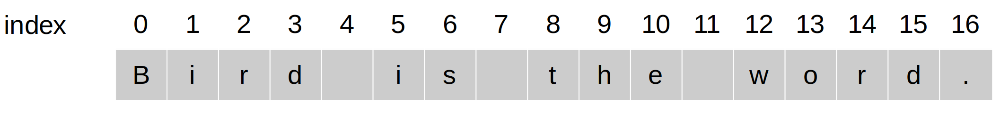
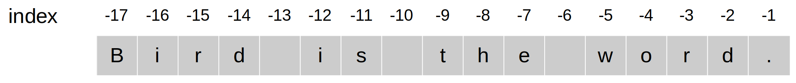
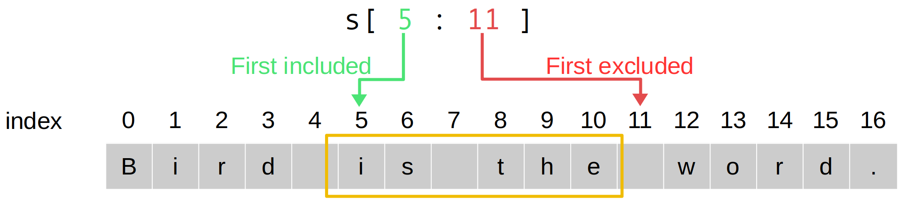
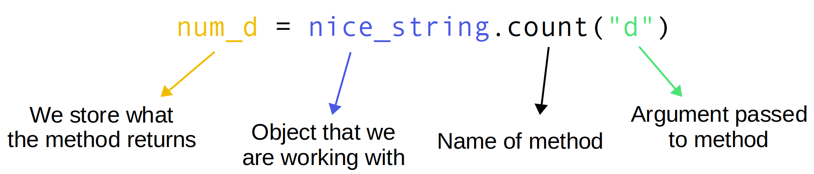

> **How to read the code boxes:** grey boxes with a yellow bar contain Python
> code. The box labelled **Output** next to it (or below it) shows what Python
> prints when you run that code.

## Strings

- A **string** represents text. Write it between quotation marks: `"Ernie"` or
  `'Bert'`, but don't mix the two.
- What we already did with strings:

```python
print("CEU"+" PU")        # concatenate
print("he"*5)             # repeat
print("Ernie"=="Bert")    # compare
print(str(7)+" dwarfs")   # convert to a string
print(int("41")+1)        # convert from a string
```

```output
CEU PU
hehehehehe
False
7 dwarfs
42
```

## Accessing characters

- `len` returns the number of characters, including spaces and punctuation.

```python
s = "Bird is the word."
print(len(s))
```

```output
17
```

- A string is a sequence of characters, and each character has an **index**.
  Indexing starts from **0**.

{width=60% alt="Indices of the string \"Bird is the word.\""}

- The square brackets `[]` look up the character at an index. An index out of
  range gives an `IndexError`. As always, read error messages carefully, starting
  at the bottom.

```python
print(s[10])
print(s[19])
```

```output
e
IndexError: string index out of range
```

- You can also count from the back with negative indices:

{width=60% alt="Negative indices of the same string"}

```python
print(s[-1], s[-11])
```

```output
. s
```
::: pagebreak
:::
## Slicing

- `[]` can also access substrings. The first number is the first index
  **included**, the second is the first index **excluded**.

{width=60% alt="The slice s[5:11]"}

- Leave out the first number to start at the beginning, or the second to go to
  the end.

```python
print(s[5:11])
print(s[:5])
print(s[12:])
```

```output
is the
Bird 
word.
```


## Methods

- **Methods** are functions that are bound to an object. Write the object's name,
  a dot `.` and the name of the method, then the arguments in parentheses. The
  method always has access to its object, so you don't pass it as an argument.

```python
nice_string = "Dodo bird"
num_ds = nice_string.count("d")
print(num_ds)
```

```output
2
```

{width=60% alt="Calling a method"}

- Strings come with [many methods](https://www.w3schools.com/python/python_ref_string.asp),
  for example:

```python
print("  void  ".strip())                          # remove whitespaces at both ends
print("I am a dog person.".replace("dog", "cat"))  # takes 2 arguments
print("nemecsek".capitalize())                     # takes no arguments
print("educated cat".find("cat"))                  # index of the first occurrence
print("educated cat".find("dog"))                  # -1 if not found
```

```output
void
I am a cat person.
Nemecsek
3
-1
```

::: pagebreak
:::
## Changing a string

- A method like `.replace()` creates a **new string**. The original stays
  unchanged:

```python
s = "Vera is four years old."
new_s = s.replace("four", "five")
print("Original:", s)
print("New:", new_s)
```

```output
Original: Vera is four years old.
New: Vera is five years old.
```

- To change the original, overwrite it. You can make several changes in one line
  by **chaining** the methods:

```python
s = "Vera is four years old."
s = s.replace("four", "five").replace(".", "!")
print(s)
```

```output
Vera is five years old!
```

## f-strings

- Building messages with `+` and `str()` is cumbersome and difficult to read:

```python
num_diners = 7
num_pizzas = 12
message = "The " + str(num_diners) + " diners get "
message += str(num_pizzas/num_diners) + " pizzas each."
print(message)
```

```output
The 7 diners get 1.7142857142857142 pizzas each.
```

- An **f-string** is prepended with the letter `f`, and can include variables and
  expressions in curly brackets `{}`. Formatting options can set, for example, the
  number of digits of a float ([more options](https://docs.python.org/3/tutorial/inputoutput.html#tut-f-strings)).

```python
print(f"The {num_diners} diners get {num_pizzas/num_diners} pizzas each.")
print(f"The {num_diners} diners get {num_pizzas/num_diners:.3f} pizzas each.")
```

```output
The 7 diners get 1.7142857142857142 pizzas each.
The 7 diners get 1.714 pizzas each.
```

## Escape sequences

- Pressing enter inside a string gives an error, since it starts a new line in
  the code:

```text
s = "Do I contradict myself?
Very well then I contradict myself,"
```

```output
SyntaxError: unterminated string literal (detected at line 1)
```

- The backslash `\` gives the next character a special meaning. This is an
  **escape sequence**: `\n` is a line break, `\t` is a tab, `\"` is a quotation
  mark and `\\` is an actual backslash.

```python
print("Do I contradict myself?\nVery well then I contradict myself,")
```

```output
Do I contradict myself?
Very well then I contradict myself,
```

- Triple quotation marks `"""` define a **multi-line string**, which allows line
  breaks inside:

```python
poem = """There was an old person of Minety
Who purchased five hundred and ninety"""
print(poem)
```

```output
There was an old person of Minety
Who purchased five hundred and ninety
```

::: {.box .mistakes}
### Common mistakes

- **Index off by one:** the last index of a string is its length minus 1, so
  `s[len(s)]` gives an `IndexError`. Use `s[-1]` for the last character.
- **Expecting the end of a slice to be included:** `s[5:11]` stops at index 10.
- **Not saving the result of a string method:** `s.replace("four", "five")` on its own
  line leaves `s` as it was. Write `s = s.replace("four", "five")`.
- **`replace` and `find` also match inside words:**
  `"educated cat".replace("cat", "dog")` gives `"edudoged dog"`. There is no
  error, so check the result.
- **Case sensitivity:** `"Dodo bird".count("d")` is `2`, since the capital `D` does
  not count.
:::

## Summary

| Term / code            | Meaning                                                  |
|------------------------|----------------------------------------------------------|
| `len(s)`               | number of characters                                     |
| `s[0]`, `s[-1]`        | first character, last character                          |
| `s[5:11]`              | substring from index 5 up to, but not including, index 11 |
| `IndexError`           | the index is out of range                                |
| `s.method(...)`        | call a method of the string `s`                          |
| `s.count(x)`           | number of occurrences of `x`                             |
| `s.strip()`            | new string without whitespaces at both ends                   |
| `s.replace(a, b)`      | new string with `a` replaced by `b`                      |
| `s.capitalize()`       | new string with a capital first letter                   |
| `s.find(x)`            | index of the first occurrence of `x`, or `-1`            |
| `f"{x} {y:.2f}"`       | f-string: insert values into a string, with formatting   |
| `\n`, `\t`, `\"`, `\\` | line break, tab, quotation mark, backslash               |
| `"""..."""`            | multi-line string                                        |
